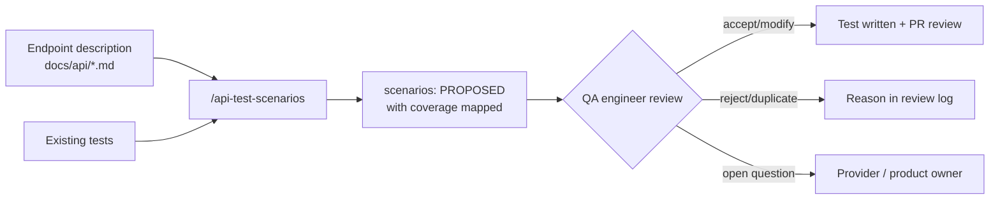
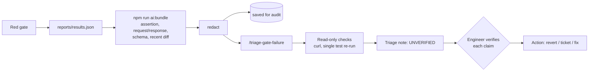

# AI in quality engineering

## Where AI helps, and where it doesn't

| Use | Value | Risk | Approach here |
| --- | --- | --- | --- |
| Scenario generation from API docs | Fast first draft; finds gaps in coverage and in the docs | Invents expected behaviour | Output is PROPOSED; every row reviewed in `ai-review-log.md` |
| Failure triage | Faster root-cause hypotheses from evidence already captured | Confident but wrong; data leakage | Redacted bundle; output UNVERIFIED until each claim is checked |
| Requirements analysis | Spots ambiguity ("what status for bad credentials?") | Low | Open questions go to the provider/product owner |
| Test-data generation | Realistic synthetic variety | Accidental real-looking personal data | Builders stay the source of truth; AI suggests edge cases only |
| Test maintenance | Suggests updates when contracts change | Silent weakening of assertions | Changes go through normal PR review; never auto-merged |
| Risk identification | Clusters failures and incidents by area | Spurious correlations | Input to the risk matrix, not a replacement for it |

**Not used for:** approving its own output, deciding release readiness, or
writing assertions that nobody reviews.

## Guardrails

1. **Humans decide.** AI output is a proposal. Scenarios are accepted, modified
   or rejected by a named engineer. Failure hypotheses are verified with a
   command before anyone acts on them.
2. **No secrets or personal data leave the machine.** `ai/redact.ts` removes
   auth headers, cookies, tokens, passwords, API keys, emails, phone numbers and
   IBANs. It is unit-tested, including a regression test for over-redaction,
   because masking dates destroyed evidence.
3. **Auditable.** The exact redacted input is saved alongside the output, and
   the instructions are versioned in the repo as Claude Code skills
   (`.claude/skills/`), reviewed through PRs like any other code.
4. **Approved tools only.** The skills run in Claude Code under the
   organisation's account and data-retention terms. Claude Code asks before
   each command a skill runs. The skills don't pre-approve any tools.
5. **Measured, not assumed.** Each workflow is trialled on real work in month 3
   and kept only if it saves time after review effort is counted.

## How it is packaged

| Part | What it is | Why |
| --- | --- | --- |
| `.claude/skills/api-test-scenarios` | Claude Code skill: `/api-test-scenarios [api-description]` | Reads the API description and the existing tests, then proposes scenarios with coverage mapped |
| `.claude/skills/triage-gate-failure` | Claude Code skill: `/triage-gate-failure [--grep ...] [--diff ...]` | Runs the bundle script, analyses only the redacted bundle, gathers read-only evidence |
| `ai/build-failure-bundle.ts` + `ai/redact.ts` | Plain, unit-tested scripts (`npm run ai:bundle`) | Redaction must not depend on a model following instructions. It works with any AI tool, or none |

Skills instead of scripts that call a model API: no API keys to manage,
Claude can read the repo to map coverage, and it can run read-only checks so
its hypotheses come with evidence. The redaction step stays deterministic code
because a guarantee about what leaves the machine can't depend on the model.

## Workflow 1: scenario generation



```bash
/api-test-scenarios docs/api/booking-endpoint.md
```

Worked example: [ai-examples/generated-scenarios.md](ai-examples/generated-scenarios.md)
and its review in [ai-review-log.md](ai-review-log.md). Result: 30 proposals, 29 already
covered, 1 real gap (missing nested `checkout`), 6 useful documentation questions.
The model missed three areas the human-designed suite covers: unsupported
methods, content types and token tampering.

## Workflow 2: failure triage



```bash
npm run test:gate
/triage-gate-failure --with-diff        # inside Claude Code
```

Worked example: [ai-examples/failure-analysis.md](ai-examples/failure-analysis.md).
The model correctly separated "the contract is ahead of the provider" from
"the API is broken" and pointed to the commit. The human checks confirmed the
diagnosis. Checking that all 8 failures shared one cause showed that one of
them didn't name the cause in its message, which led to a clearer unit test.

## Evaluating AI output over time

| Measure | How |
| --- | --- |
| Acceptance rate | Accepted + modified ÷ proposed, from the review log |
| Novelty | Proposals not already covered ÷ proposed |
| Triage accuracy | Hypothesis ranked #1 confirmed by verification ÷ analyses |
| Time saved | Triage time with vs without, sampled during the month-3 trial |
| Harm | Count of AI-originated changes later reverted |

If acceptance or accuracy is low, the fix is the skill's instructions or its
input (more context, better redaction), not trusting the model more.
