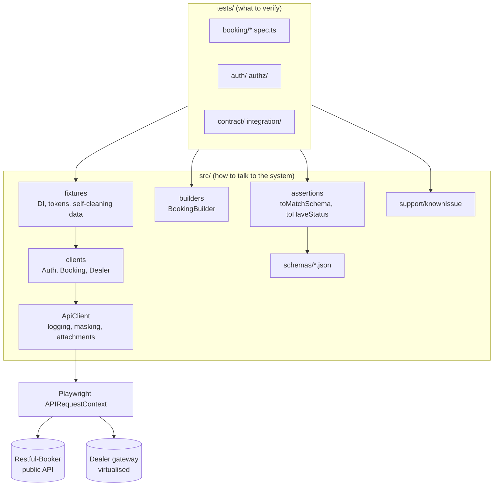
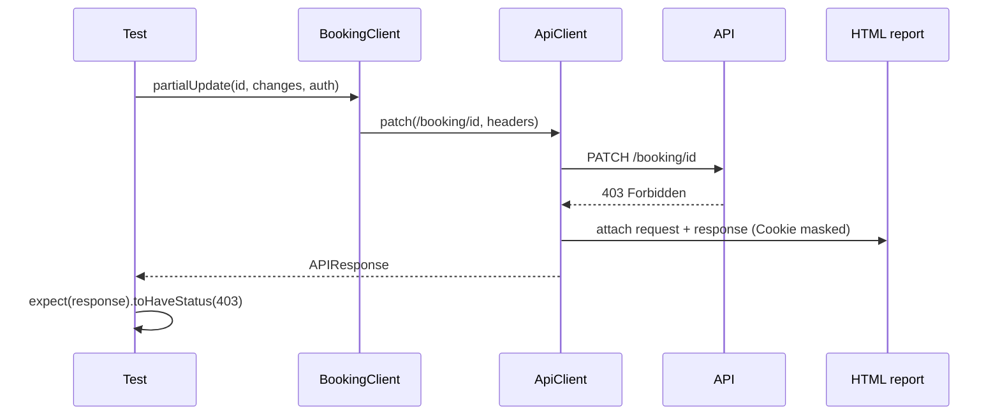
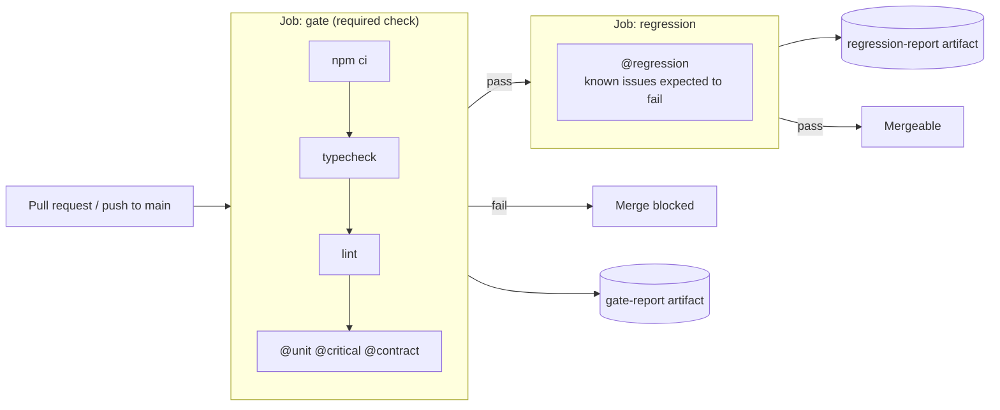
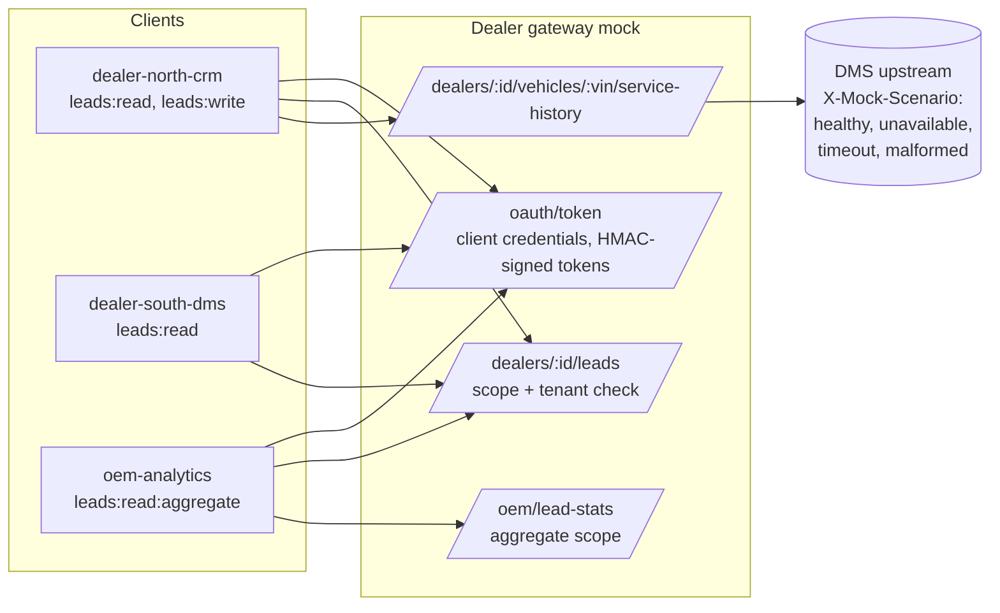

# Architecture

## Framework layers

Each layer has one job:

| Layer | Responsibility | Changes when |
| --- | --- | --- |
| Spec | States behaviour in business terms | Requirements change |
| Fixture | Wires dependencies, owns setup and teardown | Environment or auth model changes |
| Resource client | Knows paths, verbs and auth headers for one resource | The API surface changes |
| `ApiClient` | Sends requests, records evidence, masks secrets | Rarely |
| Schema | Describes what consumers rely on | The contract changes (a reviewed event) |

A URL change touches one client. An auth change touches one fixture. Specs
stay readable to people who did not write them.

## Request flow and evidence

Every exchange is attached to the test result, so a CI failure can be
diagnosed from the report artifact alone. The same attachments feed the AI
failure-analysis bundle.

## Pipeline

## Virtualised dealer gateway

The mock is about 300 lines of dependency-free Node. It's small on purpose:
anyone on the team can read it in one sitting and extend it. In a real
programme it would be replaced by, or generated from, the provider's OpenAPI
contract (WireMock, Prism, or Pact stubs).
