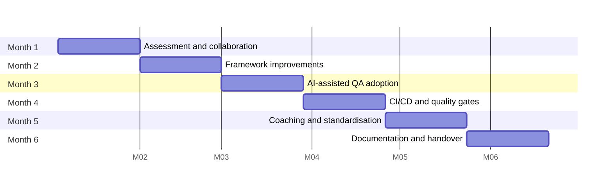

# Working with the existing framework: assessment and six-month plan

## Starting position

- An in-house automation framework exists and is actively used.
- An experienced QA engineer has owned API automation for several years and
  will keep owning it after my engagement.
- Some downstream systems are unreliable in test environments.

My role is to **extend and strengthen what exists and leave the owner stronger
than before**, not to replace the framework. A rewrite throws away years of
domain knowledge encoded in the tests, stalls delivery for months, and leaves
the owner maintaining something they didn't design. Success at month six
means the owner runs everything without me.

## Assessing the framework (weeks 1–4)

I'd do this with the owner, not to them. They know why things are the way they
are. Questions are framed as "help me understand", and findings are written
together.

| Area | What I look at | Evidence |
| --- | --- | --- |
| Value | Which tests caught real defects in the last 6 months? Which never fail? | CI history, defect tracker |
| Reliability | Flaky rate, top 10 flaky tests, retry usage | CI reports |
| Speed | Gate duration p50/p90; slowest suites | CI timings |
| Structure | Separation of tests, clients and data; duplication; how auth and environments are handled | Code walkthrough with owner |
| Data | How test data is created and cleaned; dependence on shared records | Code + environment |
| Coverage | P1 endpoints with no tests; contracts not checked | Risk matrix vs tests |
| Dependencies | Which tests fail when a downstream system is down | Failure clustering |
| Pipeline | Where tests run, what blocks a merge, what's ignored | CI config |
| Knowledge | What exists only in the owner's head | Interviews, docs |

The output is a short assessment document with a **keep / improve / add** list,
agreed with the owner and their manager. Most items should be "keep".

### Extending without disruption

- **Strangler approach for patterns.** New tests use the improved pattern
  (e.g. builders, schema matchers). Old tests migrate when someone touches them
  anyway. There is no big-bang refactor.
- **Additive first.** Contract checks, a tagged gate and virtualised dependencies
  can be added next to the existing suite without changing it.
- **Behind a flag.** New pipeline gates start as non-blocking (report-only) for
  two weeks, then become blocking once their false-positive rate is known.
- **The owner reviews every change to the framework core.** That keeps the
  design coherent and builds their ownership.

## Six-month roadmap

| Month | Focus | Key activities | Who leads | Exit criteria |
| --- | --- | --- | --- | --- |
| 1 | **Assessment and collaboration** | Shadow the owner; pair on their current work; joint framework walkthrough; risk matrix for P1 endpoints; KPI baseline; agree working agreement (review, pairing, decisions) | Me, with owner as co-author | Assessment doc and baseline signed off by owner and manager |
| 2 | **Framework improvements** | Pair on the top 3 improvements from the assessment (e.g. resource clients, data builders, schema validation); fix top 5 flaky tests; add virtualisation for the least reliable dependency | Pairing; owner drives on the second and third item | Improvements merged; flaky rate down vs baseline; owner has implemented at least one alone |
| 3 | **AI-assisted QA adoption** | Introduce scenario generation for new endpoints and failure triage; agree the review process and the redaction rules; trial on 2–3 real changes; measure time saved vs effort | Me first, then owner runs the trials | Review log in use; team decision to keep, change or drop each workflow based on trial data |
| 4 | **CI/CD and quality gates** | Tag-based gate (critical + contract) in report-only mode, then blocking; regression stage; report artifacts and PR summaries; branch protection; contract checks in provider pipelines | Owner leads; I review | Gate blocking on main; override count tracked; p90 duration within agreed budget |
| 5 | **Coaching and standardisation** | Owner presents patterns to other teams; shared templates; lint rules for conventions; QA guild started; owner reviews other teams' test PRs | Owner leads; I coach | Second team using the templates; owner running the guild |
| 6 | **Documentation and handover** | Finalise framework docs, runbooks and onboarding; ADRs for every significant decision; owner runs everything for the last 3 weeks while I only observe; retrospective | Owner | Handover checklist complete; owner and manager confirm no open dependencies on me |

## How I'd work with the owner

**Pair programming.** Two or three sessions a week, 90 minutes each, rotating
driver and navigator. In month 1 I mostly navigate on their code so I learn
the domain. From month 2 the owner drives on new patterns so the knowledge
lands in their hands, not just in the repository.

**Coaching, not instructing.**
- Start from their goals. Ask what slows them down and what they'd change if
  they had time.
- Explain the *why* behind each pattern with a concrete defect or incident it
  would have prevented.
- When we disagree, write a short ADR with both options and decide together. If
  the owner's option is reasonable, it wins: they live with it.
- Make them visible. They present improvements at the guild and in sprint
  reviews, not me.

**Introducing change while keeping delivery stable.**
- At most one framework change in flight at a time.
- Every change is behind a flag or additive, and reversible.
- New gates run report-only before blocking.
- Feature delivery tests are never paused for framework work. Improvements
  ride along with real work.

**Communicating value and decisions.**
- ADRs for significant decisions, in the repo, so the reasoning outlives the conversation.
- A monthly one-pager to the engineering manager (KPI trends, what changed, what's next).
- Demos of real catches: "this contract check stopped this change on Tuesday".

## Knowledge transfer and handover

| Artefact | Purpose | Lives in |
| --- | --- | --- |
| Framework README | What it is, quick start, commands, layout | Repo root |
| Architecture doc + diagrams | How the layers fit; where to extend | `docs/architecture.md` |
| ADRs | Why each significant decision was made | `docs/adr/` |
| Onboarding guide | A new engineer writes and merges a test on day 1 | `docs/onboarding.md` |
| Runbook | What to do when the gate is red, a test is flaky, or a mock drifts | `docs/runbook.md` |
| Defect register | Known provider issues and their tests | `docs/api-behaviour-findings.md` |
| AI usage guide + review log | How and when to use AI tooling safely | `docs/ai-in-qa.md`, `docs/ai-review-log.md` |
| Recorded walkthroughs | 3 × 20-minute videos: architecture, adding a test, triaging a red gate | Team wiki |

**Handover checklist (month 6):**

- [ ] Owner has merged changes to every framework layer without help
- [ ] Owner has triaged at least 3 red gates using the runbook alone
- [ ] Owner has onboarded one other engineer using the onboarding guide
- [ ] Every CI secret, mock and pipeline has a named owner
- [ ] All ADRs reviewed and current
- [ ] KPI dashboard runs without manual steps
- [ ] Retrospective held; open improvements in the team backlog, not in my notes

## Keeping it maintainable after I leave

- Few dependencies; nothing exotic. Playwright, Ajv and TypeScript are mainstream and well documented.
- Conventions enforced by lint and templates, not by memory.
- Every mock and every known issue has an owner and a review date.
- A quarterly framework health check (flaky rate, duration, dead tests) on the owner's calendar.
