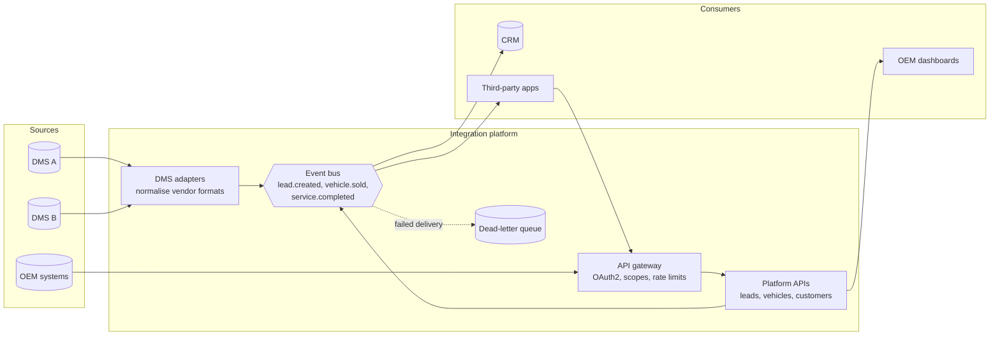

# Testing an automotive integration platform

## The platform

The platform's value is translation and trust. Many systems speak different
formats, and the platform turns them into one secure, consistent model. That
tells us where defects live: **at the boundaries.** The work is format mapping,
contract drift, auth between parties, and what happens when a neighbour is
slow, down or wrong.

## Test types and where they apply

| Type | Question it answers | Scope | Runs | Downstream systems |
| --- | --- | --- | --- | --- |
| API | Does this service behave correctly? | One service | Every PR | Virtualised |
| Contract | Do the consumer and provider agree on the shape? | One pair of systems | Every PR (consumer) and every provider build | None (contract file) |
| Integration | Does the service work with its real neighbours? | 2–3 real services | Merge to main | Real where stable, virtual otherwise |
| End-to-end | Does the business journey work? | DMS → platform → CRM | Nightly and pre-release | Real (sandbox tenants) |
| Event | Are events published, shaped and ordered correctly? | Producer and consumer | Every PR | Embedded broker / test topic |
| Resilience | Does the platform degrade safely? | Service + faulty neighbour | Merge to main | Virtualised failure modes |

## Contract testing

Use **consumer-driven contracts** (for example Pact) between the platform and
each consumer, and between each DMS adapter and the platform's canonical model:

1. The consumer writes down what it needs (fields, types, status codes) as a contract.
2. The provider's pipeline verifies that it still satisfies every published contract **before it deploys**.
3. A broker tracks which versions are compatible, so "can I deploy?" becomes a query, not a meeting.

This repository shows the consumer half with JSON Schema against a live
provider (`tests/contract`). The `demo/require-currency.patch` change shows the
failure the approach exists to catch: a consumer requiring a field the provider
doesn't send. For events, the same idea applies to message schemas, with a
schema registry and compatibility rules (backward compatible by default).

## Service virtualization and unavailable dependencies

DMS vendor sandboxes are often slow, rate-limited, shared or simply down. The
strategy is to **stop depending on them for the gate:**

| Situation | Approach |
| --- | --- |
| Dependency has a published contract | Generate stubs from it (Pact stubs, Prism from OpenAPI) |
| Dependency has no contract | Record real traffic once, review it, replay it (WireMock record/playback); re-record on a schedule |
| Need failure modes | A programmable mock with scenario switches, as in `mock/dealer-gateway` (`X-Mock-Scenario: dms-timeout`) |
| Stateful flows (create, then read) | Lightweight in-memory mock like the gateway's lead store |
| Real system needed | Keep it for nightly E2E with dedicated sandbox tenants; never make the PR gate wait on it |

Mocks drift from reality, so they need their own guard. Stubs come from the
contract the provider verifies, and a nightly job compares recorded real
responses with the stubs and raises drift as a ticket.

## Authentication and authorisation between parties

- **Machine-to-machine:** OAuth2 client credentials per integration, with
  scopes per capability (`leads:read`, `leads:write`, `stats:aggregate`).
- **Tenant isolation:** every dealer-scoped resource checks the token's tenant
  against the path. This is the highest-risk area on a multi-tenant platform:
  broken object-level authorisation (OWASP API1) leaks one dealer's customers
  to another.
- **Test matrix:** for every endpoint, tests run as owner, other tenant,
  read-only client, wrong role, expired token, forged token and no token. Each
  refusal is asserted along with "nothing changed".
- **Security in CI:** the auth matrix runs in the gate. A DAST scan (OWASP ZAP
  API scan) runs nightly against the staging gateway. Secrets come from the CI
  secret store and never from the repository.

## GDPR and test-data privacy

| Principle | Practice |
| --- | --- |
| No production personal data in test | Synthetic data from builders; generated VINs and opaque customer references |
| If production-like data is unavoidable | Irreversible masking at extraction (names, emails, phones, VIN-to-owner links), approved by the DPO, with documented retention |
| Data minimisation | Tests create only the fields they need; contracts flag unexpected personal fields (`additionalProperties: false`) |
| Right to erasure | A test verifies the delete/anonymise flow across platform and downstream copies (CRM, events, DLQ) |
| Logs and reports | `ApiClient` masks auth headers; AI tooling redacts emails, phones and IBANs before any model call |
| AI tools | No secrets, tokens or production data are ever sent; only redacted bundles, which are saved for audit |

## Integration failure handling

What the tests verify about how the platform behaves, not just the happy path:

| Failure | Expected platform behaviour | Test |
| --- | --- | --- |
| DMS unavailable | 503 with `Retry-After`; caller can retry safely | `integration/dms-resilience.spec.ts` |
| DMS slow | Times out within budget (504), no hanging connections | same |
| DMS returns garbage | 502 with a clean problem body; upstream payload not leaked | same |
| Duplicate delivery | Idempotent processing (same event ID → one lead) | Event consumer tests with replayed messages |
| Poison message | Moved to DLQ after N attempts, alert raised, rest of the stream continues | Event tests with a malformed message |
| Out-of-order events | `vehicle.sold` before `lead.created` is handled or parked, never lost | Event ordering tests |
| Partial failure | No half-written state across systems (outbox/saga) | Integration test that kills the downstream mid-flow |

## Scaling across teams

- **A shared library, not a central team.** Clients, builders, matchers and the
  gate workflow ship as a versioned internal package with templates. Each team
  owns its own tests. The platform QA team owns the paved road, not every test.
- **Contracts as the integration point.** Teams stay independent by agreeing on
  contracts, not by sharing E2E environments.
- **Standards through templates and linting.** Tagging conventions, schema
  strictness and "no sleeps" are checked automatically, so standards don't
  depend on one reviewer.
- **Guild, not gatekeeper.** A fortnightly QA guild reviews patterns and
  proposals. Teams can diverge with a short ADR.
