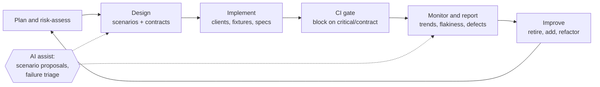

# Test strategy

## Lifecycle



| Stage | What happens | Output |
| --- | --- | --- |
| Plan | Score endpoints by risk (matrix below), agree scope with the owning engineer | Prioritised backlog |
| Design | Scenarios per endpoint: happy, negative, boundary, auth, contract. AI may propose; a person decides | Reviewed scenario list |
| Implement | Extend clients, builders and schemas; write specs | Tagged tests |
| CI | Gate on `@critical` + `@contract`; regression after | Pass/fail with evidence |
| Monitor | Duration, flakiness, failure causes, defect leakage | KPI dashboard ([kpi-framework.md](kpi-framework.md)) |
| Improve | Remove low-value tests, close gaps found in incidents | Updated backlog |

## Risk-based endpoint prioritisation

Each factor is scored 1 (low) to 5 (high). Priority = sum of
weight × score, with weights agreed with product and engineering. The weights
below are a starting point:

| Factor | Weight | What 5 looks like |
| --- | --- | --- |
| Business criticality | 3 | Revenue or legal obligation depends on it |
| Usage frequency | 2 | On the hot path of most integrations |
| Integration dependencies | 2 | Many consumers or downstream systems |
| Security risk | 3 | Writes data, crosses tenants, handles auth |
| Historical defects | 2 | Repeated incidents or escaped bugs |
| Failure impact | 3 | Silent data corruption, not just an error page |
| Data sensitivity | 2 | Personal or financial data (GDPR scope) |

### Applied to the demo APIs

| Endpoint | Crit. | Usage | Deps | Security | Defects | Impact | Data | Score | Tier |
| --- | ---: | ---: | ---: | ---: | ---: | ---: | ---: | ---: | --- |
| `POST /auth` | 5 | 5 | 5 | 5 | 2 | 5 | 3 | **75** | P1: gate |
| `GET /dealers/:id/leads` | 5 | 4 | 4 | 5 | 2 | 5 | 5 | **75** | P1: gate |
| `POST /booking` | 5 | 4 | 3 | 2 | 4 | 5 | 4 | **66** | P1: gate |
| `PUT/PATCH /booking/:id` | 4 | 3 | 3 | 4 | 3 | 5 | 4 | **65** | P1: gate |
| `GET /booking/:id` | 4 | 5 | 4 | 1 | 2 | 3 | 5 | **56** | P1: gate (contract) |
| `DELETE /booking/:id` | 3 | 2 | 2 | 5 | 2 | 5 | 2 | **55** | P1: gate |
| Service history (DMS proxy) | 2 | 3 | 5 | 3 | 3 | 3 | 3 | **52** | P2: regression |
| `GET /booking` (list/filter) | 3 | 4 | 2 | 1 | 1 | 2 | 2 | **36** | P2: regression |
| `GET /ping` | 1 | 1 | 1 | 1 | 1 | 1 | 1 | **17** | P3: smoke only |

Tiers: **P1 ≥ 55** (in the merge gate), **P2 35–54** (regression after the gate), **P3 < 35** (smoke or nightly).

Scores for the demo are judgement calls made explicit. On the real platform,
"Usage" comes from gateway traffic, "Defects" from the incident tracker, and
"Data" from the data classification register. That makes the matrix
repeatable, not opinion. Re-score each quarter, or after an incident.

### What a P1 endpoint gets first

1. Contract check on every response shape consumers depend on
2. Happy-path lifecycle
3. Authentication and authorisation, including "refused and nothing changed"
4. Negative tests for the inputs most likely to corrupt data

## Balancing the layers

```
            ▲ cost, time, flakiness
   ┌───────────────┐
   │   E2E (few)   │  journeys across DMS → platform → CRM; nightly / pre-release
   ├───────────────┤
   │  Integration  │  real service + virtualised neighbours; per merge to main
   ├───────────────┤
   │   Contract    │  consumer expectations vs provider; every PR (gate)
   ├───────────────┤
   │  API / unit   │  behaviour of one service; every PR (gate)
   └───────────────┘
            ▼ speed, precision
```

**Why critical API and contract tests run before E2E:**

- **Speed.** The gate runs about 50 checks in around 10 seconds of test time. An E2E journey across three systems takes minutes and needs every system up.
- **Precision.** A contract failure names the field and the endpoint. An E2E failure says "the lead didn't appear in the CRM", and someone spends an hour finding out why.
- **Availability.** API and contract tests run against stubs when a DMS is down. E2E tests can't, so making them the gate means the gate is red for reasons nobody can fix.
- **Cost of a mistake.** Most integration defects on a platform like this are contract mismatches. Catching them at the PR is the cheapest place to catch them.

E2E tests still matter. They prove that the wiring works. They are kept few,
focused on business-critical journeys, and run where their cost is acceptable.

## Authentication and authorisation strategy

| Concern | Tests | Where demonstrated |
| --- | --- | --- |
| Token issuance | Valid → token matches schema; invalid → no token | `auth/authentication.spec.ts` |
| Missing credentials | 401 with `WWW-Authenticate` challenge | `authz/dealer-access.spec.ts` |
| Invalid / forged / tampered token | Refused, and the resource is unchanged | both |
| Expired token | 401 with `error_description="expired"` | `authz` (mock TTL control) |
| Scope enforcement | Read-only client can't write (403 `insufficient_scope`) | `authz` |
| Tenant isolation (BOLA) | Dealer A can't read or write Dealer B | `authz` |
| Role separation | OEM sees aggregates only, not dealer records | `authz` |
| 401 vs 403 semantics | Tracked as provider defect RB-007 on Restful-Booker | `auth` known issue |

The rule for every negative auth test: assert the refusal **and** that nothing
changed. A 403 that still applied the change is the worst kind of defect, and a
status-only assertion misses it.

## Test data

- **Builders, not fixtures files.** `BookingBuilder.aBooking().withPrice(0).build()` states only what matters to the test.
- **Unique by default.** Surnames carry pid, time and sequence, so parallel workers and shared environments don't collide.
- **Self-cleaning.** The `bookings` fixture deletes what the test created, even when the test fails.
- **Synthetic only.** No production data in test environments. The mock's customer references are opaque IDs. See [integration-test-strategy.md](integration-test-strategy.md#gdpr-and-test-data-privacy).

## Flakiness policy

- One retry in CI to absorb public-API cold starts. A test that passes on retry is reported as **flaky** in the run summary, not hidden.
- A flaky test gets a ticket within one working day. If it's still flaky after a week, it's quarantined (moved to `@regression` with an owner and a date).
- No `waitForTimeout` and no sleeps. If something needs polling, poll a condition with a deadline.
